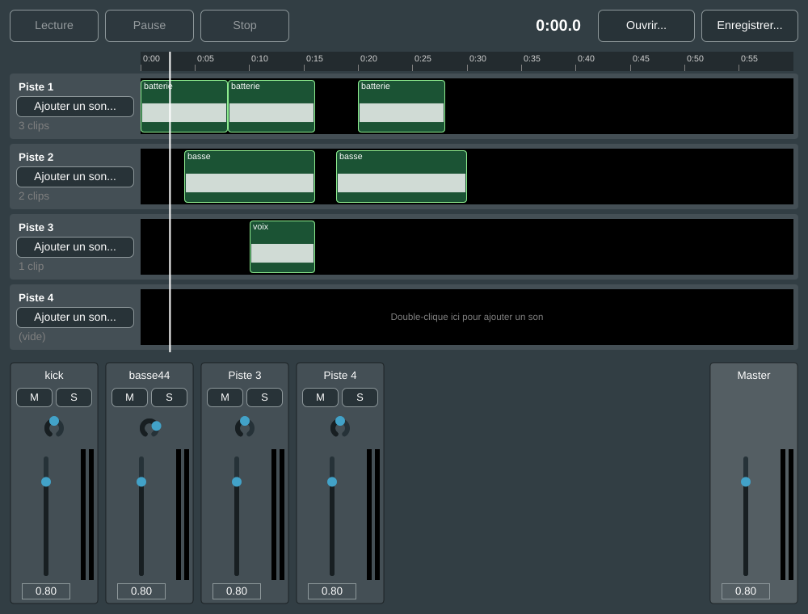

# Guide des étapes de MonDAW

Ce guide raconte comment MonDAW s'est construit, étape par étape. Pour chaque étape, il donne :
**ce que ça fait**, **les fichiers concernés**, **comment ça marche**, **ce que tu apprends** et
**des exercices** pour t'approprier le code.

Lis-le avec le code ouvert à côté dans Visual Studio. Pour les bases du langage (variables, classes,
pointeurs...), garde aussi [BASES_CPP.md](BASES_CPP.md) sous la main.

---

## Vue d'ensemble : comment le programme est organisé

```
Main.cpp                 crée la fenêtre
└── MainComponent        la fenêtre + le moteur de mixage
    ├── Track  ×4        le "modèle" d'une piste : fichier + réglages (pas d'affichage)
    ├── Track  : Clip    chaque piste contient plusieurs clips (étape 6)
    ├── TimelineRuler    la règle du temps (étape 6)
    ├── TrackRow ×4      vue Édition : nom de piste, bouton « Ajouter un son... »
    │   └── TrackLane       la bande noire où sont posés les clips
    │       └── ClipComponent   un clip à l'écran : forme d'onde, glisser, supprimer
    ├── PlayheadOverlay  la ligne blanche de la tête de lecture
    ├── MixerStrip ×4    vue Mix : Mute, Solo, panoramique, fader, vumètre
    │   └── LevelMeter      dessine le vumètre
    └── MixerStrip       la tranche Master
```

Deux idées reviennent partout :

1. **Le modèle et les vues sont séparés.** `Track` contient les données (le son, le volume...).
   `TrackRow` et `MixerStrip` les affichent et les modifient. C'est l'organisation de tous les
   logiciels un peu gros : on peut ajouter une nouvelle vue sans toucher au son.
2. **Il y a deux "fils d'exécution" (threads).** Le *thread de l'interface* gère les clics et le
   dessin. Le *thread audio* fabrique le son, des centaines de fois par seconde, et ne doit jamais
   attendre. Ils se parlent à travers des variables `std::atomic` (voir l'étape 3).

---

## Étape 1 : un lecteur de fichier WAV

**Ce que ça fait** : une fenêtre avec « Ouvrir », « Lecture », « Stop » et un fader de volume.

**Fichiers** : `CMakeLists.txt`, `Source/Main.cpp`, `Source/MainComponent.h/.cpp`.

**Comment ça marche**

- `CMakeLists.txt` est la recette de construction. `FetchContent` télécharge JUCE tout seul, et
  `juce_add_gui_app` déclare une application avec fenêtre.
- `Main.cpp` contient la classe `MonDAWApplication`. JUCE l'appelle au démarrage (`initialise`)
  et elle crée une `MainWindow`, qui affiche un `MainComponent`.
- `MainComponent` hérite de `juce::AudioAppComponent`. Grâce à cet héritage, JUCE ouvre la carte
  son et appelle trois fonctions pour nous :
  - `prepareToPlay` une fois, avant de démarrer : « prépare-toi, voici la fréquence d'échantillonnage » ;
  - `getNextAudioBlock` en boucle : « donne-moi les 512 prochains échantillons » ;
  - `releaseResources` à la fin.
- Pour lire un fichier, trois objets JUCE s'emboîtent :
  `AudioFormatManager` (sait lire WAV et AIFF) → `AudioFormatReaderSource` (lit *ce* fichier) →
  `AudioTransportSource` (lecture, arrêt, position).

**Ce que tu apprends** : la structure d'une app JUCE, les classes, l'héritage, les lambdas
(`button.onClick = [this] { ... };`).

**Exercices** (déjà faits ✔) : les 4 exercices de [BASES_CPP.md](BASES_CPP.md).

---

## Étape 2 : la forme d'onde et la tête de lecture

**Ce que ça fait** : le dessin du son s'affiche, une ligne blanche suit la lecture, et un clic
dans le dessin déplace la lecture. Ton bouton Pause est arrivé ici.

**Fichiers** : `Source/WaveformView.h/.cpp` (nouveau). À l'étape 6, ce fichier a été remplacé par
`ClipComponent`, qui dessine la forme d'onde de chaque clip.

**Comment ça marche**

- `juce::AudioThumbnail` lit le fichier en arrière-plan et en garde un résumé (un point pour 512
  échantillons). C'est ce résumé qu'on dessine, sinon ce serait beaucoup trop lent.
- `paint()` est appelée par JUCE chaque fois qu'il faut redessiner. On y dessine le fond noir, puis
  la forme d'onde (`drawChannels`), puis la tête de lecture (`drawLine`).
- Un `juce::Timer` appelle `timerCallback()` 30 fois par seconde. On y demande `repaint()`, ce qui
  fait avancer la tête de lecture.
- `mouseDown` et `mouseDrag` reçoivent les clics. On convertit la position en pixels en secondes
  avec une règle de trois : `secondes = x / largeur × durée`.

**Ce que tu apprends** : dessiner (`juce::Graphics`), réagir à la souris, les timers.

**Exercices**

1. Change la couleur de la forme d'onde (cherche `lightgreen` dans `WaveformView.cpp`). Les
   couleurs disponibles sont dans `juce::Colours`. Tape `juce::Colours::` et Visual Studio te les liste.
2. Rends la tête de lecture plus épaisse (le dernier nombre de `drawLine`).

---

## Étape 3 : le vumètre

**Ce que ça fait** : deux barres (gauche et droite) montrent le niveau du son, du vert au rouge.

**Fichiers** : `Source/LevelMeter.h/.cpp` (nouveau).

**Comment ça marche**

C'est la première fois que les deux threads doivent se parler, et c'est là que la règle d'or
de l'audio compte vraiment.

- **Côté audio**, dans `getNextAudioBlock`, on mesure le pic du bloc (`getMagnitude`) et on le
  dépose avec `meter.setLevel(...)`. Cette fonction ne fait qu'écrire un nombre : pas de dessin,
  pas d'attente.
- **Côté interface**, le timer du vumètre récupère ce nombre 30 fois par seconde (`exchange`),
  le fait redescendre doucement (`× 0.85`) et redessine.
- Le nombre est stocké dans un `std::atomic<float>`. Un `atomic` garantit qu'un thread ne lira
  jamais un nombre « à moitié écrit » par l'autre.
- L'échelle est en **décibels** (de -60 dB à 0 dB), comme sur une vraie console. C'est l'unité qui
  correspond à notre oreille : chaque -6 dB divise l'amplitude par deux.

**Ce que tu apprends** : les threads, `std::atomic`, les décibels.

**Exercices**

1. Fais redescendre le vumètre plus lentement : remplace `0.85f` par `0.95f`.
2. Change l'échelle pour qu'elle commence à -40 dB au lieu de -60 dB (`minDecibels`).

---

## Étape 4 : 4 pistes et la console de mixage

**Ce que ça fait** : 4 pistes jouées ensemble, une vue Édition (formes d'onde) et une console
façon Pro Tools (Mute, Solo, panoramique, fader, vumètre, Master).

**Fichiers** : `Source/Track.h/.cpp`, `Source/TrackRow.h/.cpp`, `Source/MixerStrip.h/.cpp` (nouveaux),
`Source/MainComponent.cpp` (réécrit).

**Comment ça marche**

- **`Track`** est le modèle d'une piste. Ses réglages (`gain`, `pan`, `mute`, `solo`) sont des
  `std::atomic`, puisque l'interface les écrit et que le thread audio les lit.
- **`MixerStrip`** ne connaît pas l'audio. Quand on bouge le fader, il appelle `onGainChange`, et
  c'est `MainComponent` qui a branché ce callback sur la bonne piste :
  `strip->onGainChange = [track] (float value) { track->gain = value; };`.
  On pourra donc réutiliser la même tranche pour autre chose, comme le Master.
- **Le mixeur**, c'est `MainComponent::getNextAudioBlock`. Pour chaque piste :
  1. on lit son bloc dans un tampon préparé à l'avance (`trackBuffer`) ;
  2. on applique le mute/solo, le volume et le panoramique ;
  3. on envoie son niveau à son vumètre ;
  4. on l'additionne dans la sortie (`addFrom`). **Mixer, c'est additionner.**
  Ensuite, on applique le volume du Master.
- **Le panoramique « à puissance constante »** : gauche = cos(angle), droite = sin(angle). Au centre,
  chaque côté reçoit 0,707, et le son paraît aussi fort qu'à gauche ou à droite.
- **La synchronisation** : toutes les pistes avancent dans le *même* appel de
  `getNextAudioBlock`, donc elles ne peuvent pas se décaler. Pause, c'est juste
  `playing = false` : le mixeur arrête de les faire avancer.
- **`OwnedArray`** est un tableau qui détruit tout seul les objets qu'il contient. On s'en sert pour
  les 4 pistes, les 4 lignes et les 4 tranches.

**Ce que tu apprends** : séparer modèle et vue, les callbacks (`std::function`), un vrai moteur de
mixage.

**Exercices**

1. Passe à 6 pistes. Une seule ligne suffit (`numTracks` dans `MainComponent.h`). Regarde comment
   tout le reste s'adapte.
2. Ajoute un bouton « C » (centre) dans `MixerStrip` qui remet le panoramique à 0. Inspire-toi de
   `muteButton`.

---

## Étape 5 : enregistrer et rouvrir une session

**Ce que ça fait** : les boutons « Enregistrer... » et « Ouvrir... » sauvent tout ton mixage dans un
fichier `.mondaw` : quels sons sur quelles pistes, volumes, panoramiques, mute, solo et Master.

**Fichiers** : `Source/MainComponent.cpp` (fonctions `saveSession` et `openSession`), plus de petits
ajouts dans `Track`, `TrackRow`, `MixerStrip` et `WaveformView` (`clear`, `loadFile`, `setGain`...).

**Comment ça marche**

- Le fichier de session est du **XML**, un format texte à balises. Ouvre un `.mondaw` avec le
  Bloc-notes pour le lire :
  ```xml
  <MonDAWSession version="1">
    <Master gain="0.80"/>
    <Track number="1" file="C:\Users\...\batterie.wav" relativeFile="batterie.wav"
           gain="0.50" pan="-0.70" mute="0" solo="0"/>
  </MonDAWSession>
  ```
- **Enregistrer** : on crée un `juce::XmlElement`, on lui ajoute un enfant par piste
  (`createNewChildElement`), on remplit ses attributs, puis `writeTo` écrit le fichier.
- **Ouvrir** : `juce::XmlDocument::parse` relit le fichier. Pour chaque piste, on vide la ligne
  (`clear`), on recharge le son (`loadFile`) et on remet les réglages avec `strips[i]->setGain(...)`,
  etc. Ces fonctions bougent le fader à l'écran **et** préviennent la piste, comme si tu l'avais
  fait à la main.
- **Les sons ne sont pas copiés** : la session retient seulement où ils sont. Elle garde deux chemins.
  Le chemin complet sert si les sons n'ont pas bougé, et le chemin relatif (« batterie.wav, à côté
  de la session ») sert si tu déplaces tout le dossier. Range donc tes sessions dans le même dossier
  que leurs sons.
- Si un son est introuvable, une fenêtre le signale, et le reste de la session s'ouvre quand même.

**Ce que tu apprends** : lire et écrire des fichiers, le format XML, gérer les erreurs proprement.

**Exercices**

1. Ouvre un `.mondaw` dans le Bloc-notes, change `gain="0.50"` en `gain="0.10"`, enregistre, puis
   rouvre la session dans MonDAW. Le fader a suivi.
2. Ajoute un bouton « Nouveau » qui vide toutes les pistes et remet les réglages par défaut.
   Indice : c'est presque `openSession` sans fichier. Pour chaque piste : `rows[i]->clear()`, puis
   `strips[i]->setGain (0.8f)`, etc.
3. Sauvegarde aussi la position de lecture. Ajoute un attribut `position` à `<Master>` (avec
   `getPosition()`), puis relis-le à l'ouverture et passe-le à `seekAll`.

---

## Étape 6 : des clips sur une ligne de temps

**Ce que ça fait** : chaque piste peut maintenant contenir **plusieurs sons**, appelés **clips**,
placés où tu veux dans le temps. Une règle graduée (0:00, 0:05, 0:10...) s'affiche au-dessus des
pistes, et une ligne blanche montre la tête de lecture.

- **Ajouter un clip** : double-clique dans la bande noire d'une piste. Le son démarre à l'endroit
  où tu as cliqué. Le bouton « Ajouter un son... » le pose, lui, à la position de la tête de lecture.
- **Déplacer un clip** : clique dessus et glisse vers la gauche ou la droite.
- **Supprimer un clip** : clic droit sur le clip, puis « Supprimer le clip ».
- **Déplacer la lecture** : clique dans la règle ou dans une zone vide d'une piste.
- La lecture s'arrête toute seule à la fin du dernier clip. La ligne de temps fait au moins
  60 secondes, et s'agrandit si tes clips vont plus loin.



**Fichiers**

| Fichier | Rôle |
|---|---|
| `Source/Clip.h/.cpp` (nouveau) | Un clip : son fichier, sa position de départ, et le son lui-même en mémoire. |
| `Source/Track.h/.cpp` (réécrit) | Une piste contient maintenant une **liste** de clips (`addClip`, `moveClip`, `removeClip`) et sait les mélanger (`render`). |
| `Source/Timeline.h` (nouveau) | La conversion temps ↔ pixels, la règle graduée et la ligne de tête de lecture. |
| `Source/ClipComponent.h/.cpp` (nouveau) | Un clip à l'écran : on le dessine, on le glisse, on le supprime. |
| `Source/TrackRow.h/.cpp` (réécrit) | La ligne de piste et sa bande noire (`TrackLane`) qui contient les clips. |
| `Source/MainComponent.h/.cpp` | Une seule horloge de lecture pour tout le morceau, et des sessions en version 2. |
| `Source/WaveformView.h/.cpp` | **Supprimé** : remplacé par `ClipComponent`. |

**Comment ça marche**

- **Un clip = un son + une position.** Dans `Clip.h`, un clip retient le fichier (`file`), l'instant
  où il démarre (`startSeconds`) et le son lui-même (`audio`). Au chargement, tout le fichier est lu
  en mémoire d'un coup (`Clip::load`). C'est simple et rapide à jouer. En contrepartie, un très long
  fichier prend beaucoup de mémoire : les vrais DAW lisent le disque petit à petit. On verra ça
  avec Tracktion Engine.
- **Le bon nombre d'échantillons par seconde.** Ta carte son tourne par exemple à 48 000 échantillons
  par seconde. Si un fichier est en 44 100, `Clip::load` le convertit (avec
  `juce::LagrangeInterpolator`), sinon il jouerait trop vite et trop aigu.
- **Une seule horloge.** Avant, chaque piste avait son propre lecteur. Maintenant, `MainComponent`
  garde **un seul compteur**, `playPosition` : le numéro de l'échantillon en cours. À chaque bloc
  audio, `getNextAudioBlock` demande à chaque piste « donne-moi ce que tu joues entre
  `playPosition` et `playPosition + 512` », puis avance le compteur. Toutes les pistes restent donc
  parfaitement synchronisées.
- **Comment une piste fabrique son son (`Track::render`).** Pour chaque clip, on calcule s'il
  « tombe » dans le bloc demandé. Exemple : le bloc va de l'échantillon 96 000 à 96 512 (2 secondes),
  et un clip démarre à 96 200. Alors on copie le début du clip à partir de la case 200 du bloc. Les
  clips qui se chevauchent sont **additionnés** (`addFrom`).
- **Le verrou qui n'attend jamais.** Le thread de l'interface peut ajouter ou déplacer un clip
  pendant que le thread audio lit la liste. Pour éviter qu'ils se marchent dessus, la liste est
  protégée par un verrou (`juce::SpinLock`). Mais le thread audio ne doit **jamais attendre**
  (étape 3). Il utilise donc `ScopedTryLockType` : « si le verrou est libre je le prends, sinon je
  joue du silence pour ce bloc ». Ce silence dure 10 millisecondes, tu ne l'entendras pas.
- **Temps ↔ pixels.** `TimelineScale` (dans `Timeline.h`) convertit les secondes en position à
  l'écran (`timeToX`) et l'inverse (`xToTime`). La règle, les clips et la tête de lecture utilisent
  tous la même échelle, c'est pour ça qu'ils sont alignés.
- **Glisser un clip.** Dans `ClipComponent::mouseDrag`, on regarde de combien de pixels la souris a
  bougé depuis le clic, on le convertit en secondes, et on appelle `track.moveClip`. Le modèle
  (`Track`) change d'abord, puis l'affichage suit : c'est la séparation modèle / vue de la vue
  d'ensemble.
- **Sessions version 2.** Une piste contient maintenant des balises `<Clip>` :
  ```xml
  <Track number="1" gain="0.80" pan="0.00" mute="0" solo="0">
    <Clip file="C:\Users\...\batterie.wav" relativeFile="batterie.wav" start="8.00"/>
    <Clip file="C:\Users\...\batterie.wav" relativeFile="batterie.wav" start="20.00"/>
  </Track>
  ```
  Tes anciennes sessions de l'étape 5 s'ouvrent toujours : leur son est placé au début (0:00).

**Ce que tu apprends** : une liste d'objets (`std::vector<std::unique_ptr<Clip>>`), la conversion
temps ↔ échantillons ↔ pixels, la souris (`mouseDown`, `mouseDrag`, `mouseDoubleClick`, clic droit),
un menu contextuel (`juce::PopupMenu`), et partager des données entre deux threads sans bloquer.

**Exercices** (tous dans des `.cpp` : F5 suffit, pas besoin de supprimer `out`)

**Exercice 1 : changer la couleur des clips.**
Ouvre `Source/ClipComponent.cpp`, cherche `seagreen` avec Ctrl+F (ligne 23).

Avant :
```cpp
    g.setColour (juce::Colours::seagreen.withAlpha (dragging ? 0.9f : 0.6f));
```
Après :
```cpp
    g.setColour (juce::Colours::darkorange.withAlpha (dragging ? 0.9f : 0.6f));
```
F5, puis ajoute un clip : il est orange. Astuce : tape `juce::Colours::` et Visual Studio te
propose toutes les couleurs (astuce du « point magique »). `dragging ? 0.9f : 0.6f` veut dire
« 0.9 si on est en train de glisser, sinon 0.6 » : le clip devient plus opaque quand tu le tiens.

**Exercice 2 : une ligne de temps de 2 minutes minimum.**
Ouvre `Source/MainComponent.cpp`, cherche `jmax (60.0` (ligne 123).

Avant :
```cpp
    timelineScale.lengthSeconds = juce::jmax (60.0, wanted);
```
Après :
```cpp
    timelineScale.lengthSeconds = juce::jmax (120.0, wanted);
```
F5 : la règle va maintenant jusqu'à 2:00 et les clips paraissent deux fois plus étroits.
`juce::jmax (a, b)` renvoie le plus grand des deux nombres. Remets `60.0` si tu préfères.

**Exercice 3 : changer le message des pistes vides.**
Ouvre `Source/TrackRow.cpp`, cherche `Double-clique` (ligne 55). Remplace le texte entre guillemets
par `"Glisse un son ici"`, puis F5. Attention : pas d'accent dans ce texte, sinon JUCE s'arrête
avec une erreur (les accents demandent une écriture spéciale, `juce::CharPointer_UTF8`).

**Défi (plus dur)** : le clic droit propose « Supprimer le clip ». Ajoute un deuxième choix
« Remettre au début » qui place le clip à 0:00. Indice : dans `ClipComponent::mouseDown`, regarde
comment `menu.addItem (1, ...)` est utilisé et ajoute un `addItem (2, ...)`. Dans la réponse
(la fonction qui reçoit `choice`), traite le cas `choice == 2` **avant** le `if` existant : appelle
`safeThis->track.moveClip (&safeThis->clip, 0.0);` puis `safeThis->onChanged();` (après avoir
vérifié qu'il n'est pas `nullptr`).

---

## La suite prévue

| Étape | Ce qu'on ajoute | Pourquoi |
|---|---|---|
| 7 | **Effets par piste** : égaliseur et compresseur dans chaque tranche | C'est le cœur du mixage façon Pro Tools. |
| 8 | **Tracktion Engine** : moteur de DAW complet (clips, boucles, MIDI, plugins VST) | Pour la vue Session façon Ableton, sans tout réécrire nous-mêmes. |
| 9 | **Enregistrement** depuis un micro ou une carte son | Pour créer tes propres sons. |

L'ordre peut changer selon ce qui te motive le plus.
